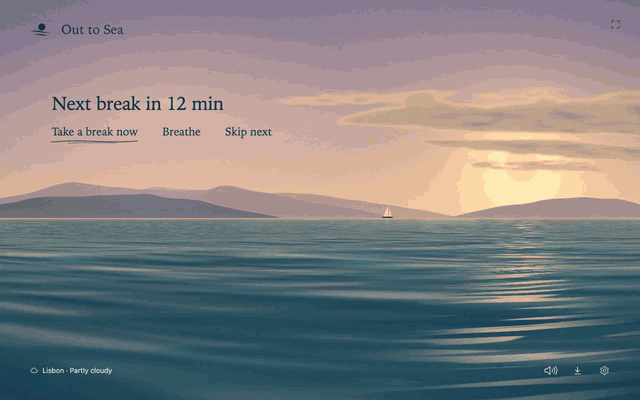
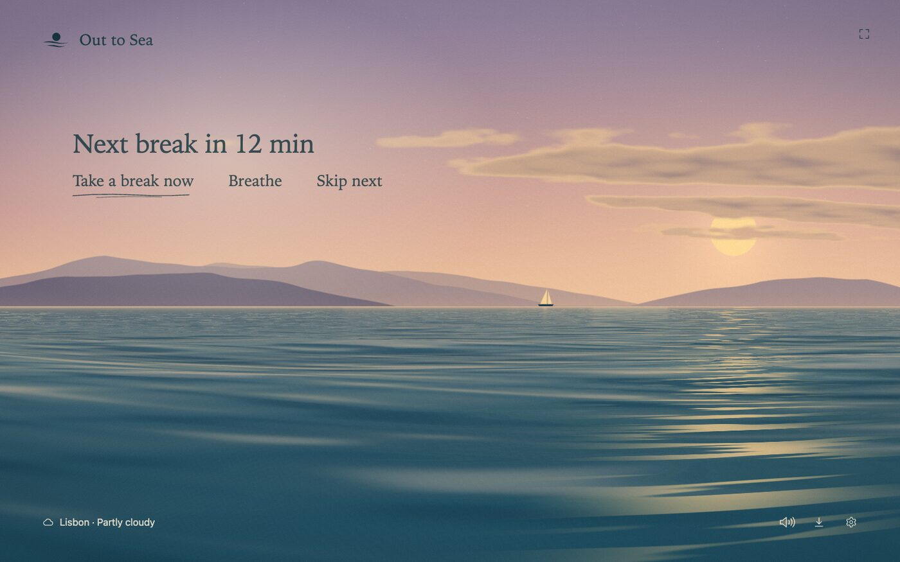
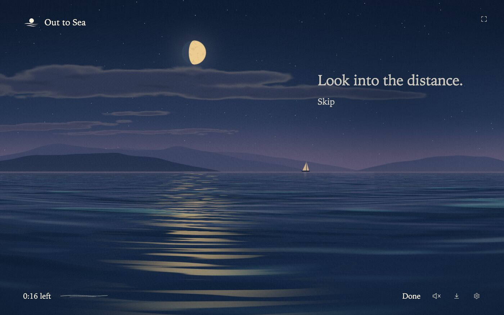
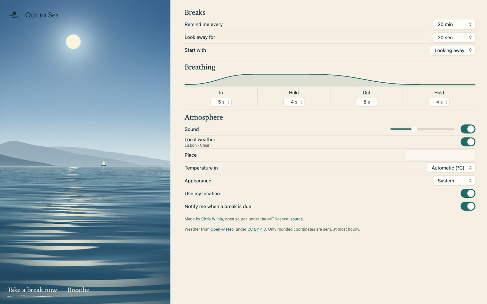
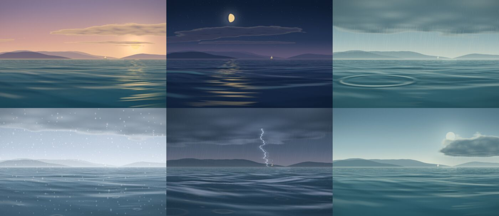

<p align="center">
  
</p>

<h1 align="center">Out to Sea</h1>

<p align="center">
  A break and breathing app for the Mac menu bar and the web.<br>
  Every so often it asks you to look into the distance, then to breathe.
</p>

<p align="center">
  <a href="https://github.com/cwdx/out-to-sea/releases/latest"></a>
  <a href="https://sea.cwdx.md"></a>
  <a href="LICENSE"></a>
</p>

<p align="center">
  <a href="docs/tour.mp4"></a>
</p>

## What it does

Out to Sea sits in the menu bar and counts down to your next break, every 20 minutes by default. When it is time, a
painted sea fills the screen and asks you to look into the distance for 20 seconds, so your eyes can rest on something
far away. Then it offers a minute or five of slow breathing, guided by a line that fills and empties with each breath.

The sea is not a video. It is drawn live on the GPU, under the sky you actually have: the sun or moon where it stands
now, the real phase of the moon, and the weather outside, from clear skies to drizzle, showers, snow, fog and
thunderstorms. Cold air thins the cloud into high streaks, warm air heaps it up, and the light shifts with both.

<p align="center">
  
  
</p>

<p align="center">
  
</p>

## Features

- **A reminder that stays out of the way.** Minutes to the next break in the menu bar; take a break now, breathe, skip
  the next one, or pause for an hour from its menu.
- **Your own sky.** Local weather from Open-Meteo, the sun and moon from your clock and position, the moon's real phase.
  Or pin any time of day, weather and temperature you like.
- **Breathing you can shape.** In, hold, out, hold: box breathing or any count up to 30 seconds a step, drawn as a curve.
- **A quiet sea to listen to.** A soft synthesised swell that follows the waves and the weather, with its own volume.
- **Full screen or a window.** Breaks cover the whole display, menu bar and Dock included, or open in a window; it
  remembers which you chose.
- **Light and dark.** Settings and the menu follow the system, or a choice of your own.
- **On the web too.** The same app runs in any browser with WebGPU, with notifications for breaks and your location
  for the sky.

<p align="center">
  
</p>

## Install

**Mac.** Download the `.dmg` for your Mac (Apple silicon or Intel) from the
[latest release](https://github.com/cwdx/out-to-sea/releases/latest), open it and drag Out to Sea to Applications.

The app is not yet signed with an Apple developer certificate, so macOS blocks the first launch and may say the app is
damaged. Clear the download flag once, then open it as usual:

```sh
xattr -dr com.apple.quarantine /Applications/OutToSea.app
```

To let a break dissolve your desktop into the sea, allow screen recording when asked; the picture never leaves your Mac.

**Web.** Open [sea.cwdx.md](https://sea.cwdx.md) in a browser with WebGPU.
Breaks remind you while the tab is open.

## Build from source

Requires [Bun](https://bun.sh) and, for the Mac app, macOS.

```sh
bun install
cd packages/out-to-sea
bun run dev:views          # the web app on a local server
bun run app                # the Mac app, into build/ and artifacts/
bun run sea out 1512 982   # every sky rendered to one sheet, with GPU timings
```

Checks: `bun run typecheck`, `bun run lint`, `bun run test` and `bun run knip` from the root.

## How it is made

| Part | Built with |
| --- | --- |
| Sea, clouds, rain and snow | WebGPU shaders in WGSL through [vgpu](https://github.com/vercel-labs/vgpu): a ray-marched cloud layer, a height-field swell and falling air measured along each view ray |
| Interface | [Vue](https://vuejs.org) and [VueUse](https://vueuse.org), with motion by [GSAP](https://gsap.com) |
| Mac app | [Electrobun](https://electrobun.dev), on [Bun](https://bun.sh) |
| Sun and moon | [SunCalc](https://github.com/mourner/suncalc) |
| Weather | [Open-Meteo](https://open-meteo.com), under CC BY 4.0; only rounded coordinates are sent, at most hourly |

## Credits

Made by [Chris Wijnia](https://chriswijnia.com). Why and how it was built:
[the note](https://chriswijnia.com/notes/out-to-sea).

## Licence

[MIT](LICENSE), © Chris Wijnia. Keep the copyright notice and licence with any copy or fork, as the licence asks.
