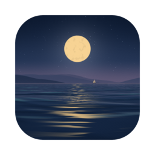

<p align="center">
  
</p>

<h1 align="center">Out to Sea</h1>

<p align="center">
  Look into the distance, then breathe.<br>
  A break app for the Mac menu bar and the web.
</p>

<p align="center">
  <a href="https://github.com/cwdx/out-to-sea/releases/latest"></a>
  <a href="https://sea.cwdx.md"></a>
  <a href="LICENSE"></a>
</p>

## Install

```sh
curl -fsSL https://raw.githubusercontent.com/cwdx/out-to-sea/main/install.sh | sh
```

This installs the latest release for Apple silicon or Intel into Applications and opens it. Prefer a download? Take the
`.dmg` from [Releases](https://github.com/cwdx/out-to-sea/releases/latest). The app isn't signed yet, so a browser
download needs `xattr -dr com.apple.quarantine /Applications/OutToSea.app` once before it opens.

No Mac? Open [sea.cwdx.md](https://sea.cwdx.md) in a browser with WebGPU.

<p align="center">
  <a href="docs/tour.mp4"></a>
</p>

## What it is

Out to Sea counts down to your next break from the menu bar. When it's time, a painted sea fills the screen and asks
you to look far away for a moment, then offers a minute of slow breathing.

The sea is drawn live on the GPU under your own sky: the sun or moon where it stands now, the moon's real phase and the
weather outside. Every choice lives in Settings.

<p align="center">
  
</p>

## Build

```sh
bun install
cd packages/out-to-sea
bun run dev:views   # the web app
bun run app         # the Mac app
```

## Credits

Made by [Chris Wijnia](https://chriswijnia.com); the [note](https://chriswijnia.com/notes/out-to-sea) tells how. Weather
from [Open-Meteo](https://open-meteo.com) under CC BY 4.0. [MIT licence](LICENSE).
